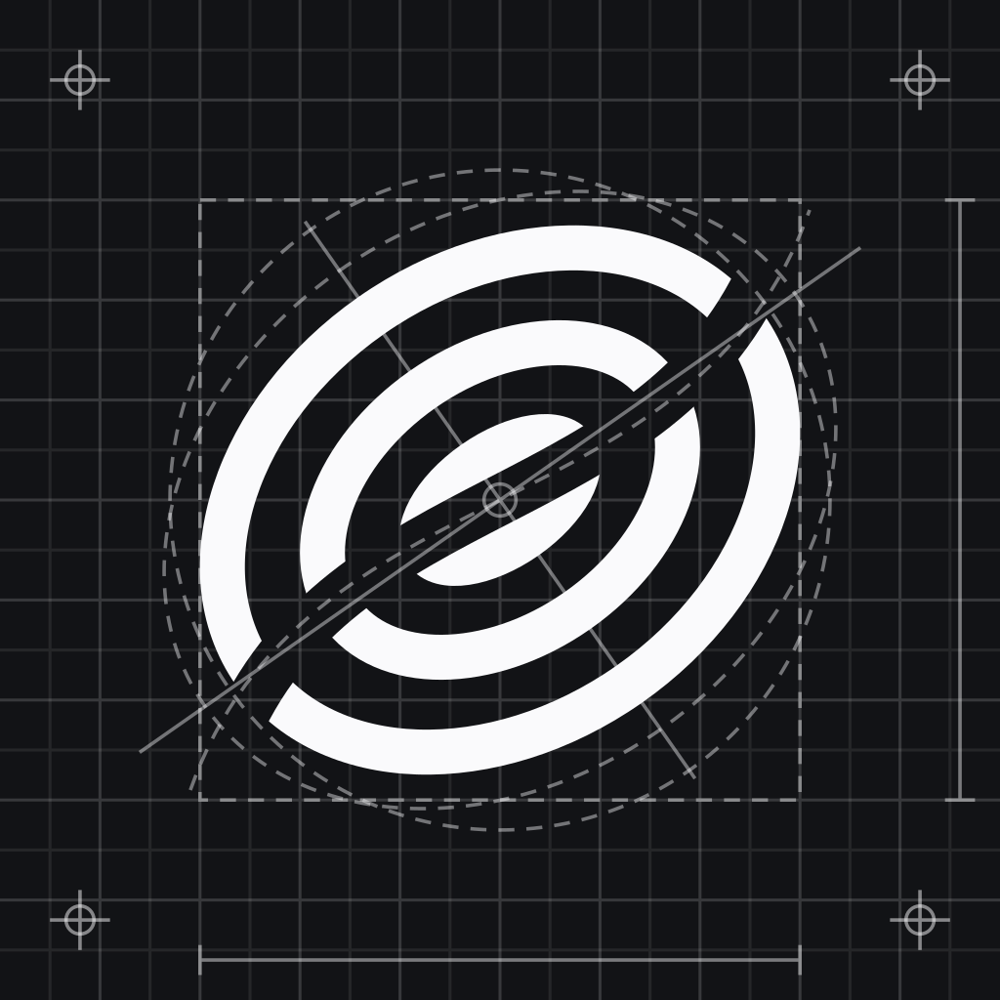

# Brewprint logo

The mark is a **print bean**: a coffee bean drawn as three nested contour lines, split by the bean's S-shaped centre line. It reads as a bean, a fingerprint (your own brew) and a drafting contour, which is the "blueprint" half of the name.

## Files

| File | Use |
| --- | --- |
| `logo/mark.svg`, `logo/mark-inverse.svg` | The mark alone on a transparent background, in near-black or off-white. |
| `logo/app-icon.svg`, `logo/app-icon-light.svg` | Full-bleed square icons. Launchers and stores apply their own mask. |
| `logo/app-icon-blueprint.svg`, `logo/app-icon-blueprint-light.svg` | Icons with a faint construction grid, for large uses such as a store listing or splash screen. |
| `logo/app-icon-construction.svg` | The construction drawing, with full grid, guides and dimension lines. For an About screen, README or presentations. |
| `logo/lockup.svg`, `logo/lockup-inverse.svg` | Mark and wordmark side by side. The wordmark is outlined, so no font is needed. |
| `png/` | PNG exports of the above. `app-icon-512.png` fits the Play Store icon slot. |

## Rules

- **Colours.** Near-black `#121316` and off-white `#FAFAFC`, the app's own monochrome pair. Construction lines use the mark's colour at low opacity, never another hue.
- **Small sizes.** At 72 dp and below, use the plain mark. The construction grid turns into noise at launcher size.
- **Safe zone.** In the square icons the mark sits inside the central 60%, so circular and squircle masks never clip it.
- **Wordmark.** "brew" in semibold and "print" in regular, lowercase. It's outlined from Inter with tightened tracking, an approximation of Inter Tight.
