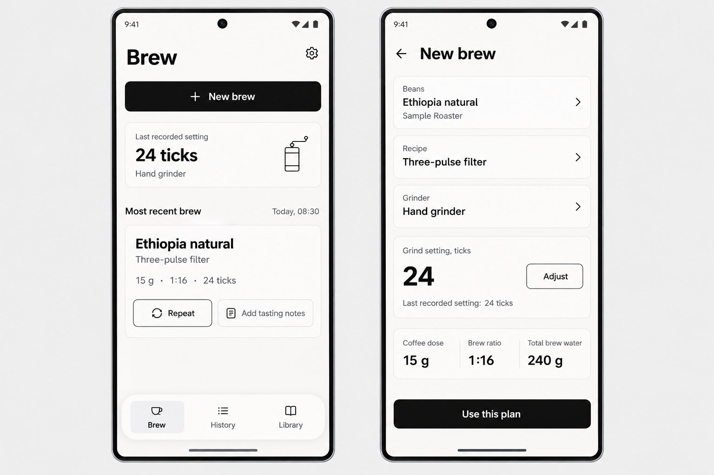
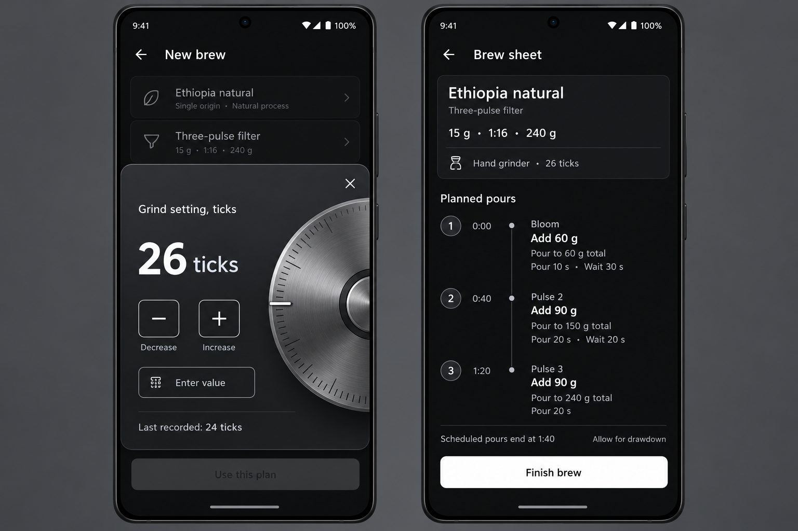
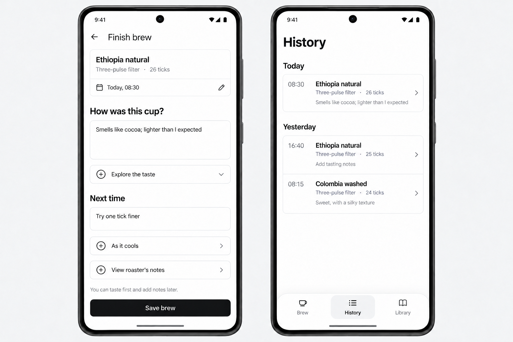

# UI mockup reference

The current visual baseline is **v1**, generated on 2026-11-01 and accepted by the owner as a rough reference for how Brewprint should look. The full-resolution PNGs are stored with the documentation so agents can inspect them from any checkout.

## Before building UI

Read [UI design direction](../../ui-design.md) and [UX journeys](../../ux.md), then open the relevant PNGs in an image viewer. The written docs define behavior, scope, and accessibility requirements; these images illustrate appearance. Resolve conflicts in favor of the written requirements and call out any visual compromise.

Match the overall hierarchy, spaciousness, monochrome light and dark appearances, softly rounded controls, and selective glass treatment. Adapt the layout to screen sizes, large text, Android system insets, and accessible touch targets. Exact pixels, typeface, palette values, corner radii, and the illustrated brushed-metal dial finish remain open as described in the design brief.

Implement responsive UI using the images as references. Sample beans, times, settings, and notes are illustrative content. Phone frames, status bars, and the surrounding presentation canvas belong to the mockup, not the app layout.

## Screens

| Reference | Left screen | Right screen |
| --- | --- | --- |
| [Brew and setup](v1/01-brew-and-setup.png) | Brew home, light | New brew setup, light |
| [Dial and brew sheet](v1/02-dial-and-brew-sheet.png) | Grind adjustment overlay, dark | Static brew sheet, dark |
| [Tasting and History](v1/03-tasting-and-history.png) | Finish brew with optional notes, light | History, newest first, light |

### Brew and setup

### Dial and brew sheet

### Tasting and History

## Coverage and revisions

Library, recipe editing, guided tasting fields, appearance settings, empty states, draft resumption, validation, and failure states are not illustrated. Build those from the written docs using the same visual language. A missing control or state in a mockup does not remove a written requirement.

The [generation prompts](v1/prompts.md) record how these images were made with built-in imagegen. They are provenance; use the design and UX docs for requirements. A [local HTML gallery](v1/index.html) is also available.

For a new visual direction, add a separate version directory and update this document's current baseline and links after owner acceptance. Keep earlier versions available so later agents can distinguish accepted direction from experiments.
