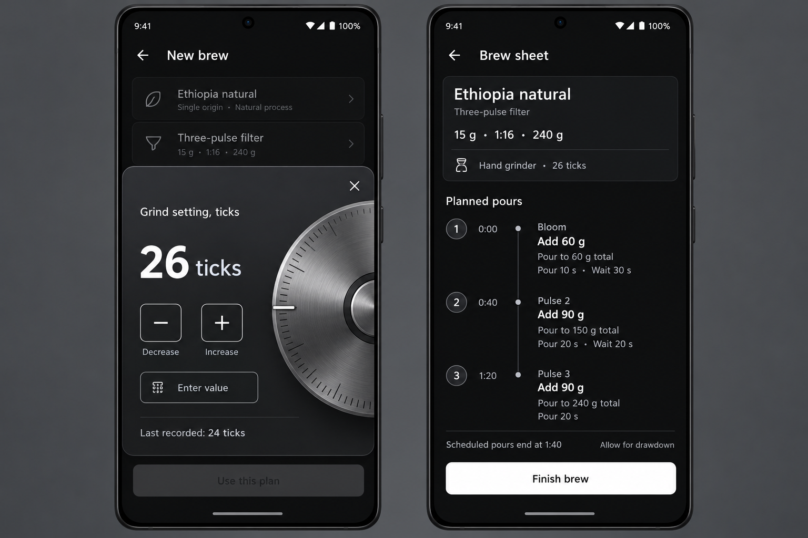
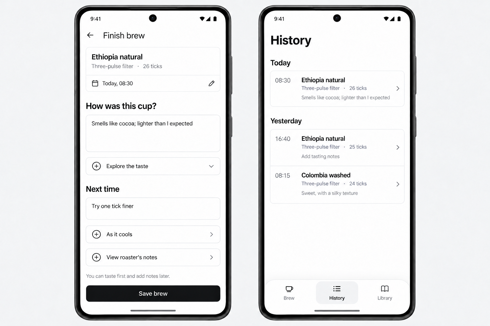

# UI mockup reference

The current visual baseline is **v1**, generated on 2026-11-01 and accepted by the owner as a rough reference for how Brewprint should look. The full-resolution PNGs are stored with the documentation so agents can inspect them from any checkout.

## Before building UI

Read [UI design direction](../../ui-design.md) and [UX journeys](../../ux.md), then open the relevant PNGs in an image viewer. The written docs define behavior, scope, and accessibility requirements; these images illustrate appearance. Resolve conflicts in favor of the written requirements and call out any visual compromise.

Match the overall hierarchy, spaciousness, monochrome light and dark appearances, softly rounded controls, and selective glass treatment. Adapt the layout to screen sizes, large text, Android system insets, and accessible touch targets. Exact pixels, typeface, palette values, corner radii, and the illustrated brushed-metal dial finish remain open as described in the design brief.

Implement responsive UI using the images as references. Sample beans, times, settings, and notes are illustrative content. Phone frames, status bars, and the surrounding presentation canvas belong to the mockup, not the app layout.

## Screens

| Reference | Left screen | Right screen |
| --- | --- | --- |
| [Brew and setup](v1/01-brew-and-setup.png) | Brew home, light | New brew setup, light |
| [Dial and brew sheet](v1/02-dial-and-brew-sheet.png) | Grind adjustment overlay, dark | Static brew sheet, dark |
| [Tasting and History](v1/03-tasting-and-history.png) | Finish brew with optional notes, light | History, newest first, light |

### Brew and setup

### Dial and brew sheet

### Tasting and History

## Brew timer

The [brew timer boards](brew-timer/index.html) were accepted by the owner on 2026-11-14 after three rounds of review. They are hand-written HTML rendered to PNG, in light appearance. Behavior is defined in [UX journeys](../../ux.md#brew-timer).

| Reference | Screens |
| --- | --- |
| [Running the timer](brew-timer/01-running.png) | Before the first pour, pour, wait, just after a skip |
| [Pause, plan, drawdown, finish](brew-timer/02-pause-plan-drawdown-finish.png) | Paused, full plan, drawdown, Finish brew review |
| [Recipes, forgotten brew, record](brew-timer/03-recipes-forgotten-record.png) | Two pulses, ten pulses, a forgotten brew, the saved record |
| [Live notification](brew-timer/04-live-notification.png) | Lock screen, collapsed and Undo, paused and drawdown, Settings |

The notification screens show the standard Android 16 progress template. How ColorOS presents it is unverified.

## Bluetooth scale

The [scale boards](bt-scale/index.html) were accepted by the owner on 2026-11-18 after a council review of three proposals. The combined flow is boards S1 and S2; boards A, B and C are the rejected proposals, kept for reference. Behavior is defined in [UX journeys](../../ux.md#brewing-with-a-scale), which supersedes the boards where they differ: a weighed dose rescales the brew's pulses, so the plan line shows the weighed dose and the ratio heads for the recipe's own ratio. [synthesis.md](bt-scale/synthesis.md) records the council's scores and reasoning.

| Reference | Screens |
| --- | --- |
| [Pairing to the first pour](bt-scale/s1.png) | Pairing offer, dose, armed, pour with live curve |
| [Waits, a lost scale, finishing, the record](bt-scale/s2.png) | Wait, scale lost, drawdown, Finish brew review, saved record |

## v2 polish (proposed)

The [v2 polish boards](v2-polish/index.html) are **proposed, awaiting the owner's review**. They refine contrast, buttons, scrolling chrome, the brew sheet chart, Finish brew, and the brew record's timing table, in light and dark. They are hand-written HTML rendered to PNG at 412 dp phone width, with a 360 dp check for the timing table. Behavior is defined in [UI design direction](../../ui-design.md) and [UX journeys](../../ux.md), which supersede the boards where they differ. Motion is described on board 2 and is reviewed in the app.

| Reference | Screens |
| --- | --- |
| [Look and feel](v2-polish/b1.png) | Brew, History scrolling and swiping, History dark with Undo, buttons and navigation parts |
| [Brew sheet](v2-polish/b2.png) | Pour and wait with the labelled chart, dark pour, motion frames |
| [Finish brew and the record](v2-polish/b3.png) | Finish brew results card, brew record, timing and water at 412 dp and 360 dp |

## Coverage and revisions

Library, recipe editing, guided tasting fields, appearance settings, empty states, draft resumption, validation, and failure states are not illustrated. Build those from the written docs using the same visual language. A missing control or state in a mockup does not remove a written requirement.

The [generation prompts](v1/prompts.md) record how these images were made with built-in imagegen. They are provenance; use the design and UX docs for requirements. A [local HTML gallery](v1/index.html) is also available.

For a new visual direction, add a separate version directory and update this document's current baseline and links after owner acceptance. Keep earlier versions available so later agents can distinguish accepted direction from experiments.
